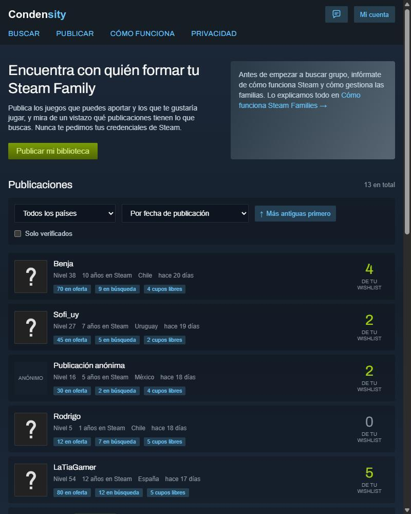
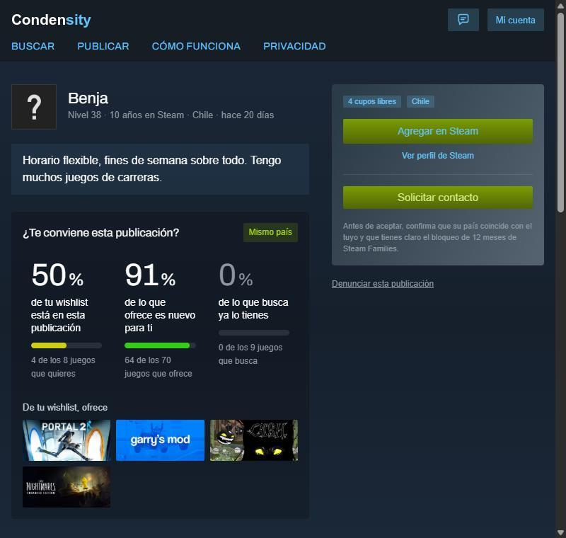
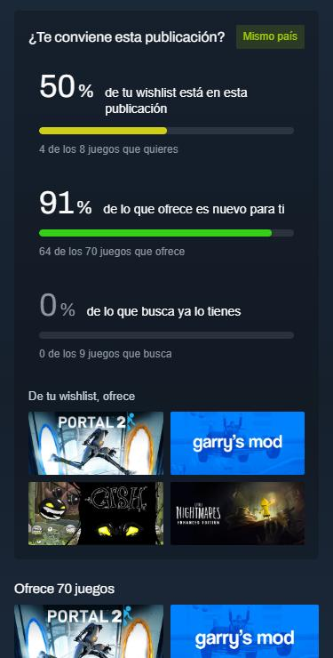

# Condensity (Ex GameNest)

### Encuentra con quién formar tu Steam Family

Página web para encontrar personas de tu país con quienes formar una Steam Family, cruzando tu biblioteca y tu wishlist con las de cada publicación de forma transparente y sin necesidad de logearse con la propia Steam, con el fin de crear comunidades y acercar personas.

  

## Funciones

- Publicar tu biblioteca con los juegos que Steam permite compartir.
- Ordenar publicaciones por coincidencias con tu wishlist y filtrarlas por país.
- Ver qué parte de tu wishlist ofrece cada publicación y cuánto sería nuevo para ti.
- Verificar tu cuenta de Steam con un código temporal en tu perfil.
- Publicar de forma anónima o solo para cuentas verificadas.
- Mensajes, bloqueos, denuncias y moderación.
- Exportar tus datos o borrar tu cuenta.

<table>
  <tr>
    <td width="66%"></td>
    <td width="34%"></td>
  </tr>
</table>

---

## Código fuente

El código fuente es privado, pero si gustas colaborar puedes enviarme un mensaje para darte acceso de lectura. La arquitectura y las medidas de seguridad están en [este doc](docs/arquitectura-y-seguridad.md).

## Autor

Pedro Morales.
