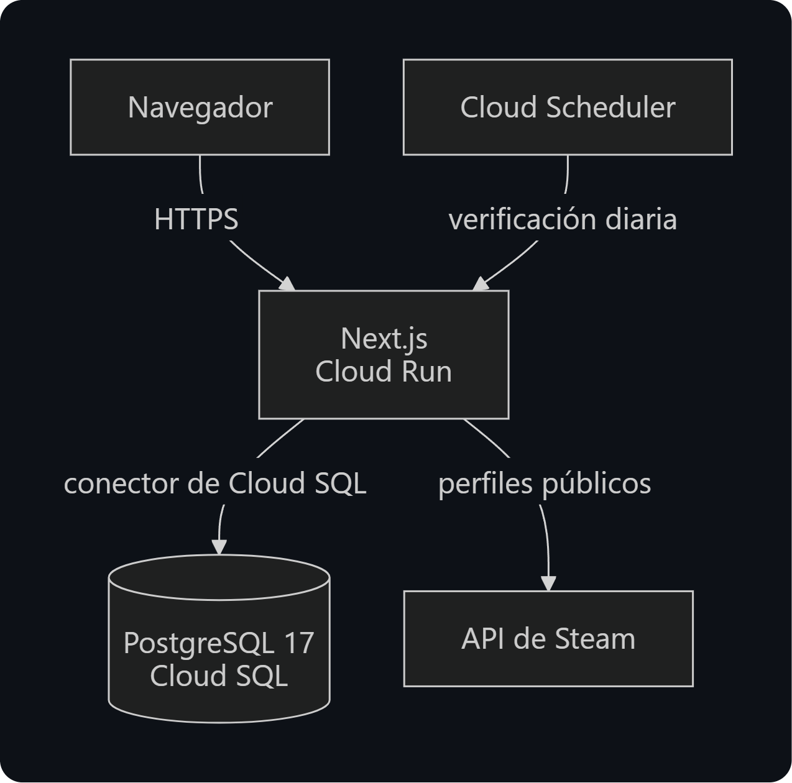
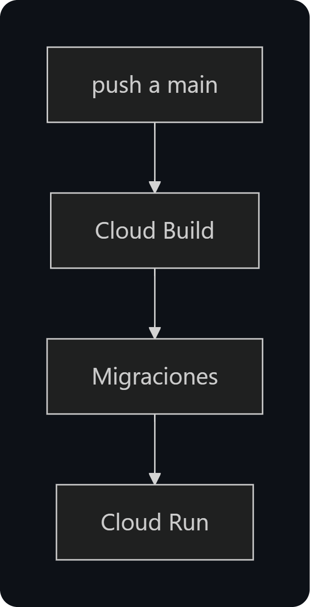
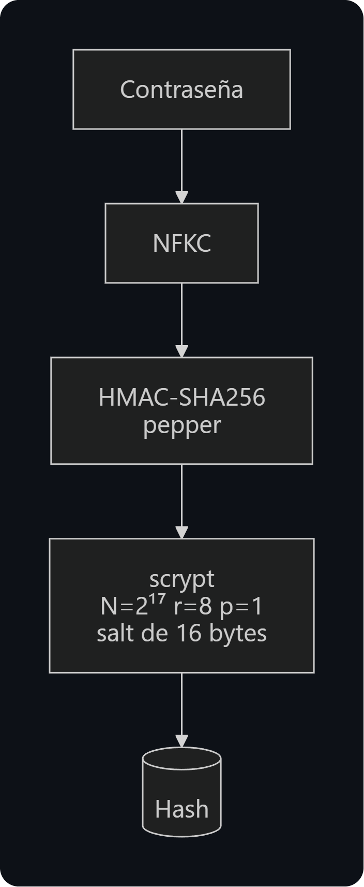
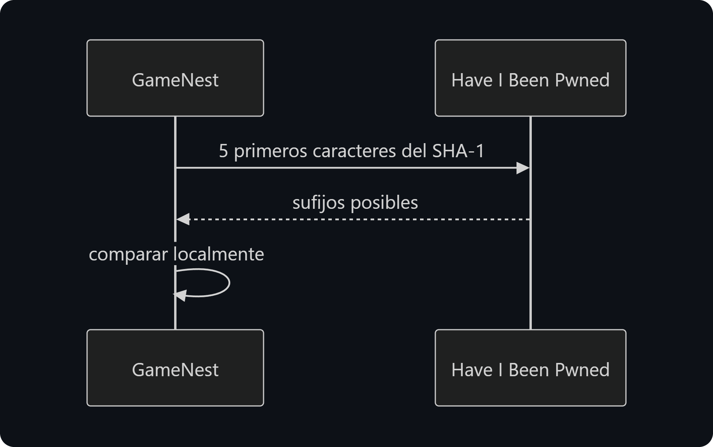
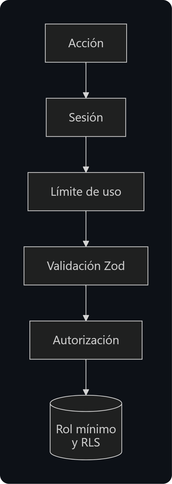

# Arquitectura y seguridad

[← Volver al README](../README.md)

## Arquitectura

  

  

La base de datos no tiene redes autorizadas por ningún motivo.

## Seguridad

### Contraseñas

  

El pepper está fuera de la base, además los hashes se recalculan solos al iniciar sesión si cambian los parámetros.

### Gestión de Contraseñas filtradas

  

### Métodos de seguridad aplicados

  

|  |  |
|---|---|
| Base de datos | Rol de la app sin permisos de estructura, RLS en todas las tablas y restricciones `CHECK` |
| Sesiones | Cookies `HttpOnly` y `Secure`, revocadas al cambiar la contraseña |
| Tokens | Enlaces de un solo uso hasheados y tokens OAuth cifrados |
| Direcciones IP | Solo como HMAC-SHA256 |
| Cabeceras | CSP con nonce, y HSTS |
| Secretos | Secret Manager, con acceso por servicio |
| Dependencias | Antigüedad mínima de 24 h y scripts de instalación bloqueados |
